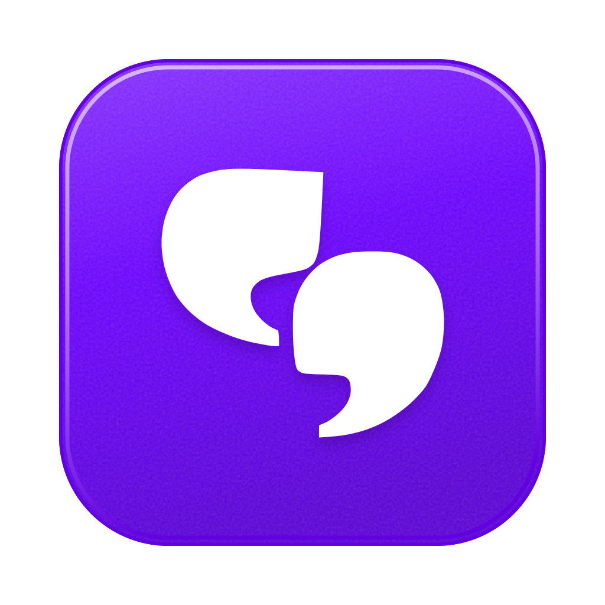
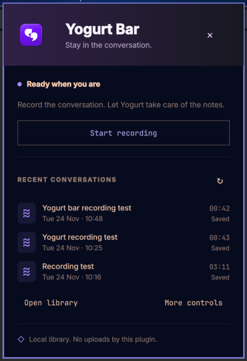

<div align="center">



# Yogurt Bar

### Stay in the conversation. Keep control in your bar.

**Start recording. See that it’s working. Save the moment.**  
A beautifully simple Omarchy companion for [Yogurt](https://yogurt.so/).

[Features](#a-little-icon-a-lot-of-peace-of-mind) · [Install](#up-and-running-in-minutes) · [Make it yours](#make-it-yours) · [Help](#a-helping-hand)


</div>

<p align="center"></p>

## A little icon. A lot of peace of mind.

You’re on a call. You want to listen, contribute and remember what matters—not
hunt through windows to find the record button.

Yogurt Bar puts the essentials where you can always find them: **in your Omarchy
bar**. A click opens your recording controls and recent conversations. When a
recording is active, a clear indicator and elapsed timer keep you informed at a
glance.

### 🎙 Start the conversation, then press record

Start recording directly from the panel. Pause for a break, resume when you’re
ready, and **Stop & save** when you’re finished. The buttons use Yogurt’s own
native controls, so Yogurt remains responsible for capturing and saving audio.

### ⏱ Know when you’re recording

A recording indicator and live session timer appear in the bar. Open the panel
for a larger timer and a clear recording or paused state. No guessing whether
you pressed the button.

### 🎨 A toolbar that makes sense

Your library and Ask Yogurt sit together for everyday navigation. The four buttons share an evenly spaced row, with Quit at the far right in a
quieter red accent.
Every action has a crisp vector icon, a visible label and a helpful hover
hint. Recording stays in its own prominent area above, with matching icons for
start, pause, resume and stop.

### ✨ Your conversations, close at hand

See your three most recent sessions, their durations and whether they’re saved,
transcribing or need attention. **Open library** takes you back to Yogurt for the
full transcript, audio and notes.

### 🌙 Made to feel at home

A rich violet header, familiar Yogurt icon, theme-aware text and understated
status colours make the panel feel like part of your desktop. Keyboard focus,
Escape to dismiss, vertical bars and multi-monitor panel routing are included.

### 🔒 Keep your library yours

The plugin reads **session metadata only**: titles, dates, durations and processing
state. It does not read your audio, transcript text or notes, modify Yogurt’s
database, or upload your library. Prefer discretion? Hide meeting titles with
one setting.

### 🧩 A companion, not another recording engine

No additional account. No API key. No background service to set up. No patch to
Yogurt is needed by this plugin. Recording controls travel through Yogurt’s
existing system-tray menu.

## Up and running in minutes

### 1. Add Yogurt Bar

You’ll need Omarchy Quattro and Python 3 (included with Omarchy).

```bash
omarchy plugin add https://github.com/BenLewies/omarchy-yogurt.git --enable
```

Prefer SSH? Use this alternative:

```bash
omarchy plugin add git@github.com:BenLewies/omarchy-yogurt.git --enable
```

### 2. Let setup do the work

Click the Yogurt icon, then **Set up Yogurt** if the panel isn’t connected.
The guided setup opens in a terminal and explains each step before asking you
whether to continue:

- **No Yogurt yet?** Download the official Linux AppImage, verify its SHA-256
  checksum and add Yogurt to your app launcher. No administrator password needed.
- **Already installed?** Keep your existing installation and launcher.
- **Tray icon switched off?** Quit Yogurt when prompted. Setup backs up its
  settings, enables the tray icon and preserves every other preference.
- **Ready to connect?** Open Yogurt and complete its first-run checks and model
  downloads. Yogurt Bar connects as soon as its tray appears.

The bundled installer supports Linux x86-64 and installs official Yogurt 0.3.72. ARM64 is ready in the installer and is offered once an official Yogurt release includes the arm64 AppImage and its checksum is pinned in `setup.py`.
It never starts a recording, enables login autostart or replaces an existing app.
Yogurt’s model downloads, hardware checks and permission choices happen in Yogurt.
Already connected? You can skip setup entirely.

You can also run guided setup directly:

```bash
python3 ~/.config/omarchy/plugins/bjl.yogurt/setup.py
```

Custom profile and launcher settings in the widget are passed to setup when you
use the button. For a terminal invocation, use `--profile /path/to/Yogurt` and
`--launcher-json '["/absolute/path/to/Yogurt.AppImage"]'` if needed.

### 3. Make it part of your day

Look for the Yogurt icon in your bar:

| What you do | What happens |
| --- | --- |
| **Left-click the icon** | Open the recording panel |
| **Right-click the icon** | Open Yogurt |
| **Start recording** | Ask Yogurt to begin capturing audio |
| **Pause / Resume** | Control the current recording |
| **Stop & save** | Ask Yogurt to finish the recording |
| **Library** | Open Yogurt’s library |
| **Ask** | Ask Yogurt about your conversations |
| **Settings** | Open Yogurt’s preferences |
| **Quit** | Quit Yogurt (at the far right of the toolbar) |
| **Escape** | Close the panel |

**Recording starts only when you choose to start it.** Adding the plugin does not
start a recording or change your call-recording preferences.

## Make it yours

The default placement is the right side of the bar. Move it using Omarchy’s bar
editor, or with:

```bash
omarchy bar move bjl.yogurt --section centerEnd
```

Optional settings live on the widget’s entry in `~/.config/omarchy/shell.json`:

```json
{
  "id": "bjl.yogurt",
  "hideTitles": true,
  "profileDirectory": "/path/to/your/Yogurt",
  "launchCommand": ["gtk-launch", "yogurt"]
}
```

You only need to add the settings you want to change:

| Setting | Default | Use it for |
| --- | --- | --- |
| `hideTitles` | `false` | Hide recent titles and calendar action titles, including tooltips and accessibility text |
| `profileDirectory` | Your XDG config folder’s `Yogurt` directory | Read a non-standard Yogurt profile |
| `launchCommand` | `["gtk-launch", "yogurt"]` | Open your preferred Yogurt installation |

With `hideTitles` enabled, optional native actions use the label **Meeting action**.
Their buttons still work; their original titles return when you disable the setting.
This setting covers the Yogurt Bar panel. Opening Yogurt uses Yogurt’s own privacy settings.

If you use an AppImage without a desktop launcher, set `launchCommand` to its
absolute path in an array, for example `["/home/you/Applications/Yogurt.AppImage"]`.
Commands are passed as arguments; they are never evaluated by a shell.

For keyboard access, bind this command using your normal Omarchy shortcut setup:

```bash
omarchy shell bjl.yogurt toggleMenu
```

## A helping hand

**“Yogurt isn’t connected” even though the app is open?**  
Check that Yogurt’s tray icon is enabled. The plugin finds Yogurt by its tray
identity, including Electron’s `Yogurt_status_icon_1` name. If you just installed
or updated the plugin, restart the Omarchy shell to clear cached QML.

**The timer or recent sessions are missing?**  
Check `profileDirectory`. The plugin reads the local `yogurt.db` in read-only
mode, including its live WAL state, and refreshes metadata every two seconds.
A locked, missing or changed database produces an unavailable state without
changing your library.

**A control is unavailable?**  
The plugin only enables controls actually published by Yogurt. Open Yogurt to
complete setup, and check that the relevant toolbar icon is enabled. Native menu phrases are recognised
across Yogurt’s bundled languages; the panel currently ships English strings
with a translation-ready catalogue.

**Does the timer exclude pauses?**  
It displays elapsed session time from the session’s start, including paused
time. It is not a measurement of the final audio file’s duration.

**Does this fix Yogurt’s call detection or transcription?**  
Those remain Yogurt features. The plugin provides controls and status; it does
not change call detection, recording, transcription, model selection or automatic
stopping. Audio and notes still live in Yogurt.

**Can I try the plugin without changing my recordings?**  
Yes. Install it, open the panel and browse the status. It doesn’t write to the
Yogurt database or start recording on installation. Use **Open library** to
return to the app.

## What setup changes

Only after you confirm, setup downloads from the official
[FrigadeHQ/Yogurt release](https://github.com/FrigadeHQ/yogurt/releases/tag/v0.3.72).
The URL and expected SHA-256 are pinned in `setup.py`; failed verification
prevents installation. There are no background download checks by this plugin.
Yogurt has its own update preferences.

A new installation goes into `$XDG_DATA_HOME/yogurt-bar/` (normally
`~/.local/share/yogurt-bar/`), with a `yogurt.desktop` launcher under
`$XDG_DATA_HOME/applications/`. The launcher uses AppImage’s extract-and-run
mode so FUSE is not required. If tray visibility needs changing, setup makes a
private `settings.json.before-yogurt-bar-*` backup alongside Yogurt’s settings.
It refuses to edit those settings while Yogurt is running.

Removing the plugin leaves Yogurt and all recordings in place. To remove an app
installed by this setup, quit Yogurt and remove only the `yogurt-bar` data folder
and its `yogurt.desktop` launcher. To undo a tray change, use Yogurt’s settings
or restore the backup while Yogurt is closed.

## Updates and removal

```bash
# Update the plugin
omarchy plugin update bjl.yogurt --yes

# Hide it from the bar
omarchy plugin disable bjl.yogurt

# Remove it
omarchy plugin remove bjl.yogurt --yes
```

Your Yogurt recordings, models, transcripts and notes remain untouched.

## For contributors

Runtime dependencies are Omarchy’s Quickshell host and Python 3. Tests also use
Node.js; there are no npm or pip dependencies to install.

```bash
python -m unittest discover -s tests -v
node tests/model.test.cjs
python tests/check_package.py
omarchy plugin validate .
```

The metadata reader is deliberately read-only. New features should keep that
boundary, invoke controls through the live native tray menu and render external
text as plain text. See [publishing notes](docs/STORE_SUBMISSION.md) for the store
submission package.

Tested with Omarchy Quattro and Yogurt 0.3.55 on Linux. Yogurt’s database and tray
menu are app-owned interfaces; future changes may require a plugin update.

---

**An independent community companion by Ben Lewies.**  
Not affiliated with or endorsed by Frigade. Yogurt’s icon and menu translations
are used under its MIT license; see [third-party notices](THIRD_PARTY_NOTICES.md).
